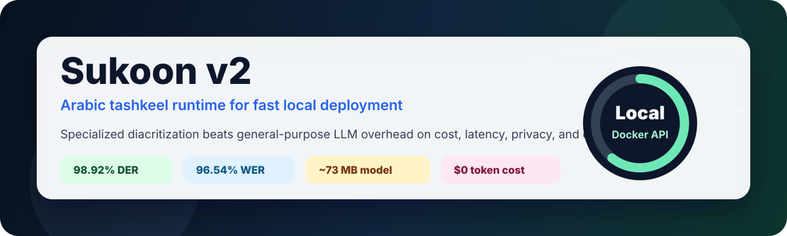
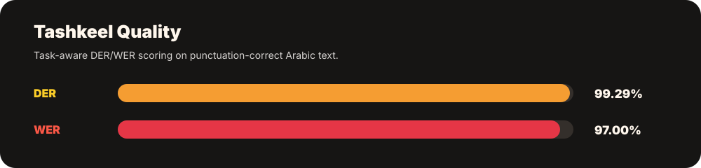
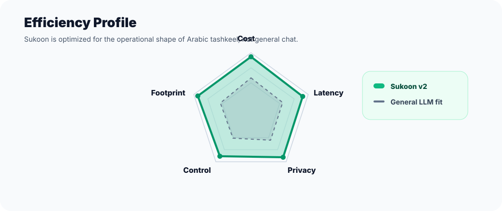
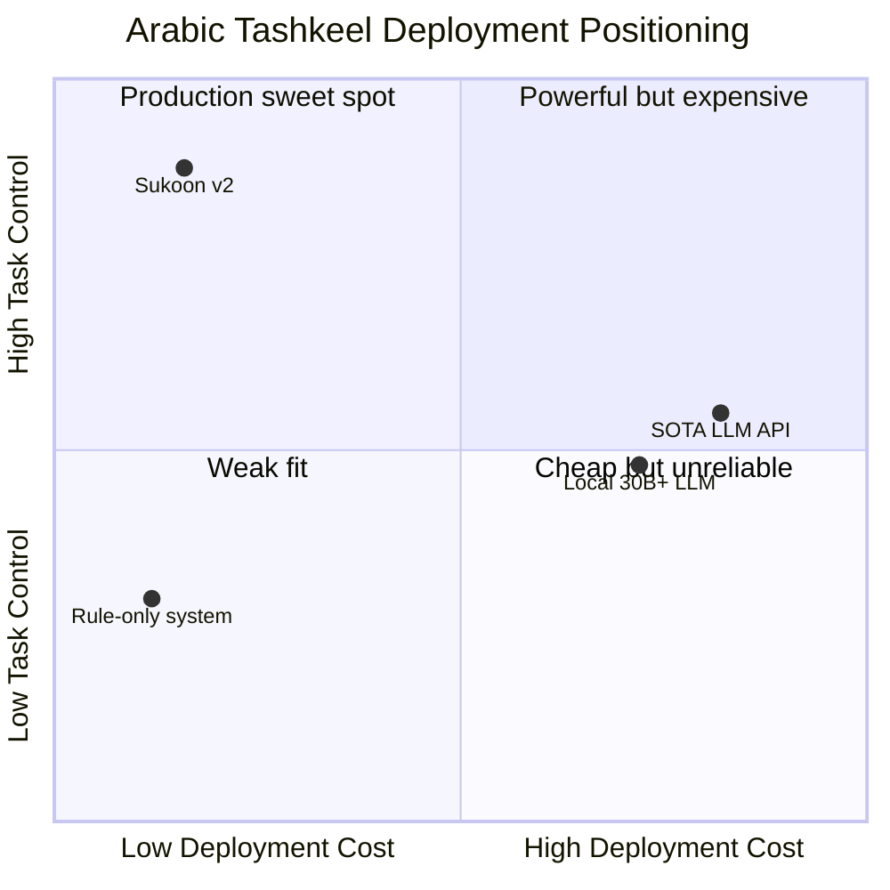
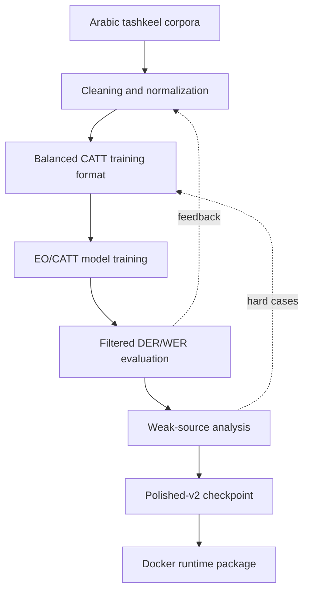

# Sukoon v2

<p align="center">
  
</p>

<h3 align="center">A compact, CPU-friendly Arabic tashkeel model built for production deployment.</h3>

<p align="center">
  <b>98.92% DER quality</b> · <b>96.54% WER quality</b> · <b>~73 MB checkpoint</b> · <b>local Docker runtime</b> · <b>zero per-token API cost</b>
</p>

Sukoon is a specialized Arabic diacritization runtime packaged as a Docker web app and HTTP API. It is designed for the exact job of adding tashkeel to Arabic text: fast, local, predictable, inexpensive, and easy to integrate.

General-purpose frontier LLMs are powerful, but they are expensive overkill for this task. Sukoon wins where a production tashkeel system actually has to win: **latency, cost efficiency, privacy, controllability, and deployment simplicity**.

## Highlights

<p align="center">
  
</p>

| Dimension | Sukoon v2 Position |
| --- | --- |
| Accuracy | Filtered full-eval quality of **98.92% DER** and **96.54% WER**. |
| Speed | Development batch evaluation reached about **9,281 words/sec**. |
| Local cost | Runs locally after build with **no token billing** and no external API calls. |
| Model footprint | Active checkpoint is only **~73 MB**. |
| Runtime | Dockerized CPU inference with a browser UI and JSON API. |
| Privacy | Text can stay on the user's machine or private server. |
| Control | Task-specific output surface: Arabic in, diacritized Arabic out. |

## Accuracy

Filtered evaluation ignores known non-task noise: hamza spelling variants, accepted tanween-alif placement differences, pause-form final-haraka suppression before strong punctuation, and wasla/definite-article variants.

<p align="center">
  
</p>

| Metric | Quality | Error |
| --- | ---: | ---: |
| DER | **98.92%** | 1.08% |
| WER | **96.54%** | 3.46% |

Full filtered evaluation scale:

| Evaluation Item | Count |
| --- | ---: |
| Aligned rows | 16,506 |
| Evaluated characters | 495,602 |
| Evaluated words | 113,955 |
| Batch-eval throughput | ~9,281 words/sec |

Source-level stress tests:

| Source | DER Quality | WER Quality | Read |
| --- | ---: | ---: | --- |
| General fixtures | **99.29%** | **97.00%** | Strong clean-text performance. |
| Quran-style text | 96.89% | 89.54% | Robust, but specialized orthography remains hard. |
| Easy Arabic News | 95.60% | 86.64% | Good on practical modern text. |
| Shamela/book style | 95.16% | 85.78% | Classical prose is harder but usable. |
| Wikipedia | 92.47% | 72.54% | Hardest observed source. |

## Cost And Efficiency

<p align="center">
  
</p>

Sukoon is not trying to be a chatbot. That is the point. By specializing tightly on Arabic tashkeel, it avoids the expensive generality of large language models.

| Capability | Sukoon v2 | General SOTA LLM API | Local 30B+ LLM |
| --- | --- | --- | --- |
| Marginal inference cost | **$0 local token cost** after setup | Token/API billing | Electricity + large hardware |
| Privacy | **Local/private** | Usually remote service | Local/private |
| Footprint | **~73 MB checkpoint** | Not locally owned | Tens of GB typical |
| Latency profile | **Small specialized decoder** | Network + autoregressive generation | Heavy autoregressive generation |
| Prompt risk | **No prompt needed for core task** | Prompt-sensitive | Prompt-sensitive |
| Output control | **Constrained tashkeel task** | Can rewrite/mutate text unless carefully constrained | Can rewrite/mutate text unless carefully constrained |
| Deployment | **One Docker command** | API key + network dependency | Model manager + high RAM/VRAM |

The key win is not that Sukoon is a bigger model. It is that Sukoon is the right shape of model: compact, Arabic-specific, and built for a repeatable production workflow.

## Competitive Positioning



Where Sukoon wins hardest:

| Strong Point | Why It Matters |
| --- | --- |
| Cost efficiency | Arabic tashkeel can run without paying per request or per token. |
| Text preservation | A specialized diacritizer is far less likely to behave like a creative text generator. |
| Small footprint | The active model is small enough to ship inside a normal Docker runtime. |
| Operational simplicity | No GPU server, no model router, no prompt orchestration. |
| Privacy | Sensitive Arabic text does not have to leave the deployment environment. |
| Predictability | Same task, same interface, same model path, same runtime behavior. |

## Live Smoke Test

| Input | Output | Observed Runtime |
| --- | --- | ---: |
| `كتب الطالب الدرس.` | `كَتَبَ الطَّالِبُ الدَّرْس.` | ~15-55 ms CPU smoke-test range |

Runtime depends on host CPU, Docker Desktop settings, and whether the model is already warm.

## Architecture

```mermaid
flowchart LR
    A[Arabic text] --> B[Docker Web UI or JSON API]
    B --> C[Python inference server]
    C --> D[Text normalization and segmentation]
    D --> E[Sukoon v2 CATT runtime]
    E --> F[Polished-v2 EO checkpoint]
    F --> G[Diacritized Arabic output]

    classDef hot fill:#eaf7f1,stroke:#2c9f72,stroke-width:2px,color:#0f2f24;
    classDef core fill:#eef2ff,stroke:#4f63d8,stroke-width:2px,color:#111a44;
    classDef out fill:#fff6db,stroke:#d49b22,stroke-width:2px,color:#3b2a08;
    class B,C,D core;
    class E,F hot;
    class G out;
```



Sukoon uses a compact CATT-style character-level transformer runtime. Instead of asking a general LLM to generate Arabic text, Sukoon predicts diacritics over the input text with a narrow output contract. That gives the system its practical edge: it is small, fast, local, and task-stable.

Runtime characteristics:

| Layer | Role |
| --- | --- |
| Web UI | Manual testing and lightweight usage. |
| HTTP API | Project integration surface. |
| Segmenter | Splits long Arabic text into safe inference chunks. |
| CATT runtime | Character-level tashkeel inference. |
| Polished-v2 checkpoint | Active Sukoon production model. |

## Training Process



The model was developed through repeated dataset polishing, source balancing, checkpoint evaluation, and targeted error analysis. The final shipped runtime uses the polished-v2 Sukoon checkpoint because it had the best practical balance of quality, speed, and stability.

Training emphasis:

| Focus | Effect |
| --- | --- |
| Clean diacritized Arabic | Strong core tashkeel behavior. |
| Punctuation-aware text handling | Better sentence and pause-form behavior. |
| Filtered quality scoring | Separates true tashkeel errors from spelling/orthographic noise. |
| Hard-source evaluation | Exposes weak points on Wikipedia, Shamela, news, and Quran-style text. |
| Runtime pruning | Keeps the deployment repo small and focused. |

## Repository Contents

| Path | Purpose |
| --- | --- |
| `Dockerfile` | Builds the CPU Docker runtime. |
| `docker-compose.yml` | Runs the local web/API service. |
| `container_demo/server.py` | Python web server and inference API. |
| `container_demo/webui/dist/` | Pre-built UI assets. |
| `runtime_models/premium/external/catt_punct_v4/` | Minimal Sukoon runtime files. |
| `runtime_models/.../catt_eo_ft_polished_v2/catt_eo_ft_best.pt` | Active model checkpoint. |

## Run Locally

Install Docker Desktop, then run:

```bash
git clone https://github.com/Dwekatious/Tashkeel.git
cd Tashkeel
docker compose up --build
```

Open:

```text
http://127.0.0.1:8765/
```

Stop:

```bash
docker compose down
```

## API

```bash
curl -X POST http://127.0.0.1:8765/api/diacritize \
  -H "Content-Type: application/json" \
  -d '{"model":"eo","text":"كتب الطالب الدرس."}'
```

Response:

```json
{
  "model": "eo",
  "output": "كَتَبَ الطَّالِبُ الدَّرْس.",
  "device": "cpu",
  "segments": 1
}
```

