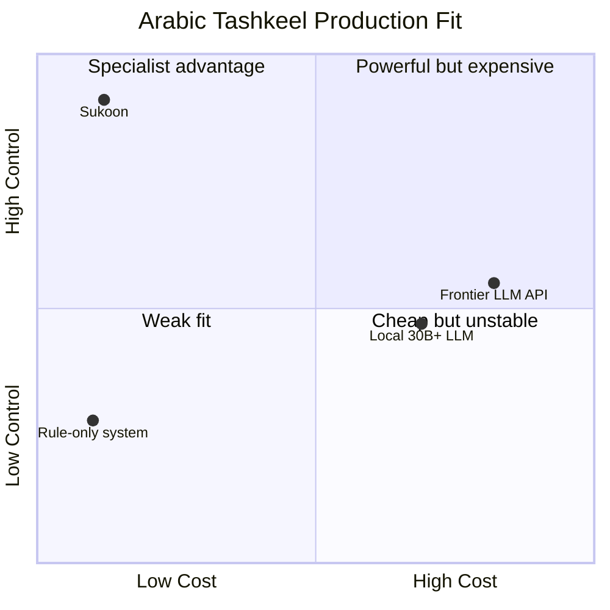
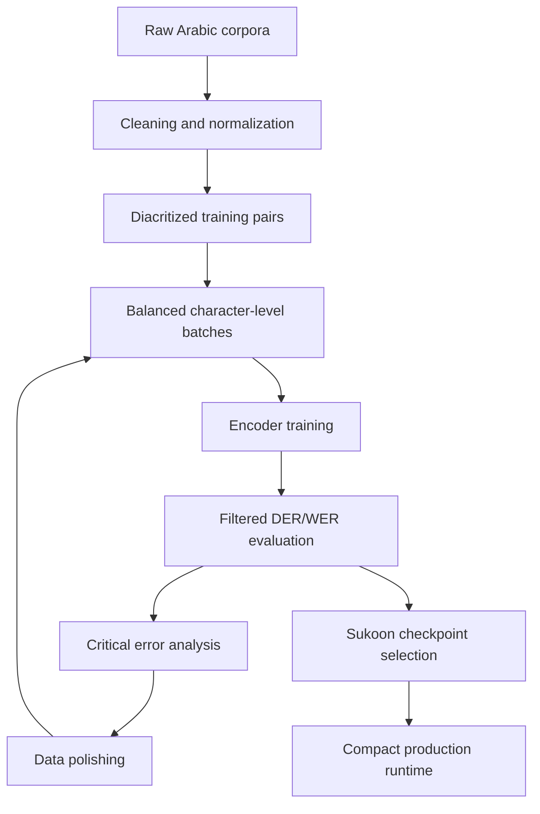

# Sukoon

<p align="center">
  
</p>

<p align="center">
  
</p>

<h3 align="center">A specialist Arabic tashkeel model engineered for accuracy, efficiency, and speech pipelines.</h3>

<p align="center">
  <b>98.92% DER quality</b> · <b>96.54% WER quality</b> · <b>~73 MB checkpoint</b> · <b>runs on tiny CPU boxes</b> · <b>pricing TBD</b>
</p>

Sukoon is a purpose-built Arabic diacritization model. It takes undiacritized Arabic text and returns the same text with tashkeel, using a compact encoder-style character system instead of a giant general-purpose text generator.

The thesis is simple: **Arabic tashkeel should not require a frontier LLM.** For this task, a dedicated model can be sharper, cheaper, faster, easier to control, and dramatically easier to integrate into real products.

## Executive Snapshot

<p align="center">
  
</p>

| Dimension | Sukoon Position |
| --- | --- |
| Accuracy | **98.92% DER quality** and **96.54% WER quality** under the filtered full evaluation. |
| Efficiency | A **~73 MB** active checkpoint, built for high-throughput CPU inference. |
| Cost profile | Pricing is **TBD**, designed for a dramatically cheaper tashkeel API tier than frontier LLMs. |
| Integration | Clean text-in/text-out behavior, ideal for preprocessing, publishing, education, and TTS. |
| Hardware | Comfortable on ordinary laptops, small servers, and low-cost CPU deployments. |
| Stability | No prompt dance, no creative rewriting, no chatbot behavior. |

## Accuracy

Filtered evaluation ignores non-task noise: hamza spelling variants, accepted tanween-alif placement differences, pause-form final-haraka suppression before strong punctuation, and wasla/definite-article variants.

<p align="center">
  
</p>

| Metric | Quality | Error |
| --- | ---: | ---: |
| DER | **98.92%** | 1.08% |
| WER | **96.54%** | 3.46% |

Full filtered evaluation scale:

| Evaluation Item | Count |
| --- | ---: |
| Aligned rows | 16,506 |
| Evaluated characters | 495,602 |
| Evaluated words | 113,955 |
| Batch-eval throughput | ~9,281 words/sec |

Stress-test profile:

| Source | DER Quality | WER Quality | Read |
| --- | ---: | ---: | --- |
| General fixtures | **99.29%** | **97.00%** | Clean, representative samples. |
| Quran-style text | 96.89% | 89.54% | Specialized orthography remains difficult, but the model stays strong. |
| Easy Arabic News | 95.60% | 86.64% | Practical modern text with varied sentence forms. |
| Shamela/book style | 95.16% | 85.78% | Classical prose is harder but usable. |
| Wikipedia | 92.47% | 72.54% | Hardest observed source. |

## Pricing Position

Sukoon pricing is **TBD**. The commercial target is clear: tashkeel should be priced like a specialized utility, not like frontier reasoning.

<p align="center">
  
</p>

Public reference prices checked on **2026-05-10**:

| Model/API | Input / 1M tokens | Output / 1M tokens | Notes |
| --- | ---: | ---: | --- |
| **Sukoon** | TBD | TBD | Intended to sit in a much cheaper specialist tier. |
| GPT-5.5 | $5.00 | $30.00 | OpenAI standard API pricing. |
| Claude Opus 4.7 | $5.00 | $25.00 | Anthropic standard Claude API pricing. |

Sources: [OpenAI API pricing](https://openai.com/api/pricing/) and [Anthropic Claude API pricing](https://platform.claude.com/docs/en/about-claude/pricing).

The point of Sukoon is not to compete with LLMs at everything. It is to make one high-volume Arabic operation inexpensive enough to use everywhere.

## Why Not Just Use A SOTA LLM?

| Requirement | Sukoon | SOTA LLM API | Local 30B+ LLM |
| --- | --- | --- | --- |
| Arabic tashkeel specialization | **Native purpose** | Prompted behavior | Prompted behavior |
| Text preservation | **Designed to preserve text** | Can rewrite or mutate text | Can rewrite or mutate text |
| Cost at scale | **Specialist pricing TBD** | High token economics | Hardware-heavy |
| Hardware footprint | **Tiny checkpoint** | Remote dependency | Tens of GB typical |
| Latency | **Small deterministic pipeline** | Network + generation latency | Heavy autoregressive decoding |
| TTS pipeline fit | **Excellent preprocessor** | Expensive and prompt-sensitive | Slow and memory-heavy |
| Operational risk | **Narrow output contract** | Broad model behavior | Broad model behavior |

General local LLMs can produce impressive Arabic, but tashkeel is not a general generation problem. The model must preserve every base character, avoid paraphrasing, handle punctuation, and output dense diacritics consistently. Sukoon is built for that pressure point directly.



## Runs On A Potato

Sukoon is intentionally small. The active checkpoint is about **73 MB**, and the runtime is CPU-first. That makes it suitable for:

| Environment | Fit |
| --- | --- |
| Developer laptop | Easy local testing. |
| Small VPS | Practical low-cost deployment. |
| Internal service | Private text processing. |
| Edge-ish CPU box | Possible where large LLMs are unrealistic. |
| TTS preprocessing pipeline | Excellent fit before acoustic/prosody stages. |

For TTS, Sukoon is especially valuable because Arabic speech quality depends heavily on vowels, endings, shadda, sukoon, tanween, and pause behavior. A cheap tashkeel preprocessor can improve downstream pronunciation without dragging a giant LLM into every synthesis request.

## Architecture


Sukoon is a specialized character-level encoder for Arabic diacritization. It does not generate a sentence from scratch. It studies the input stream at the character level, builds contextual representations, and selects the correct diacritic marks for each Arabic base character.

That design matters. Arabic tashkeel is dense, local, and grammatical. A single internal haraka can change form or meaning; a final short vowel can alter case; shadda changes the consonantal structure; tanween and sukoon affect pronunciation and downstream speech synthesis. Sukoon treats these as first-class prediction targets, not decoration.

### What We Changed And Hardened

| Area | Work Done |
| --- | --- |
| Character vocabulary | Preserved Arabic base characters while expanding the diacritic decision surface. |
| Sequence handling | Added punctuation-aware segmentation so longer passages stay stable. |
| Pause behavior | Suppressed final short vowels before strong punctuation where pause-form output is preferred. |
| Evaluation | Built filtered DER/WER scoring to separate real tashkeel errors from spelling/orthographic noise. |
| Training data | Iterated through polished corpora, hard-source analysis, and weakpoint extraction. |
| Runtime surface | Reduced the deployed model to the minimum inference path: no training machinery in the handoff. |

This was not a random fine-tune. The hard work was making the system behave like a product: stable input preservation, meaningful filtered scoring, source-level weakness analysis, inference segmentation, checkpoint selection, and a tiny deployable runtime.

## Training Process



Training was guided by repeated measurement, not vibes. Each cycle exposed where the model was weak, separated harmless orthographic mismatch from real tashkeel errors, and pushed the checkpoint toward the highest practical blend of accuracy, speed, and deployability.

## Repository Contents

| Path | Purpose |
| --- | --- |
| `Dockerfile` | Builds the CPU runtime image. |
| `docker-compose.yml` | Starts the local service for testing. |
| `container_demo/server.py` | Python web server and inference entrypoint. |
| `container_demo/webui/dist/` | Pre-built browser UI assets. |
| `runtime_models/premium/external/catt_punct_v4/` | Minimal Sukoon runtime files. |
| `runtime_models/.../catt_eo_ft_best.pt` | Active model checkpoint. |

## Run

Install Docker Desktop, then:

```bash
git clone https://github.com/Dwekatious/Tashkeel.git
cd Tashkeel
docker compose up --build
```

Open:

```text
http://127.0.0.1:8765/
```

Stop:

```bash
docker compose down
```

## Programmatic Use

```bash
curl -X POST http://127.0.0.1:8765/api/diacritize \
  -H "Content-Type: application/json" \
  -d '{"model":"eo","text":"كتب الطالب الدرس."}'
```

```json
{
  "model": "eo",
  "output": "كَتَبَ الطَّالِبُ الدَّرْس.",
  "device": "cpu",
  "segments": 1
}
```
